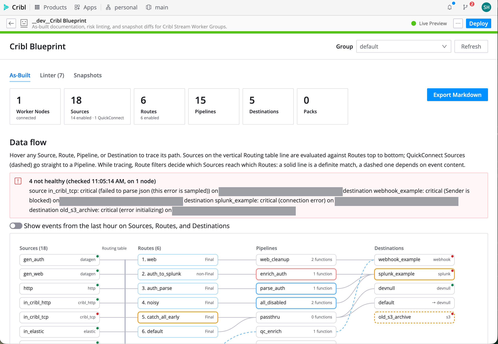

# Cribl Blueprint

Cribl Blueprint documents what is deployed in a Cribl Stream Worker Group or Edge Fleet, flags what in it is broken or risky, and keeps labelled snapshots so you can see what changed.

## Summary

Cribl Blueprint is a Cribl App for admins and consultants who inherit, audit, or hand off a Cribl Stream or Edge deployment. It generates an as-built report with a data-flow diagram and a Markdown export, shows live health and event counts next to the configuration, and traces data from Edge Fleets into Stream. It lints the configuration for risky patterns, such as silently dropped data, hardcoded secrets, shadowed routes, and duplicate delivery. It also keeps labelled snapshots, so a handoff or change review has a record of exactly what changed.



## What This App Does

* Primary purpose: as-built documentation and risk review for Cribl Stream Worker Groups and Edge Fleets.
* Key capabilities:
  * **As-Built.** Inventory of Sources, Routes (in evaluation order), Pipelines, Destinations, and Packs.
    * A Source → Route → Pipeline → Destination diagram that shows QuickConnect paths. Each object is outlined by its worst lint finding.
    * A Source × Route reach matrix read from the Route filters (never executed): which Routes each Source's events can reach, where a Final Route stops them, and which Routes no Source reaches.
    * Subfleets: listed under their parent Fleet; a subfleet's As-Built shows how many objects are inherited, overridden locally, or local, with an Origin column in every table and in the Markdown export.
    * Edge → Stream lineage: each Fleet's Cribl TCP/HTTP Destinations are matched to the Stream Source they feed (certain when the Cribl.Cloud hostname names the Worker Group, possible on a port-only match), with last-hour events on each side. A Worker Group lists the Fleets that send to it.
    * Worker and Edge Nodes: hostname, status, OS, Cribl and config version, last seen, and resources, with a warning when nodes run different config versions or report Sources and Destinations the config doesn't contain.
    * Live health: each Source and Destination in the diagram shows a green, yellow, or red dot from Cribl's status API, and anything not healthy is listed with its error.
    * Live events: last-hour event counts on Sources, Routes, and Destinations, and in every reach-matrix cell, so a "?" becomes evidence. Cells where events arrived although the filters say they can't are flagged.
    * A Source → Destination matrix: where each Source's data ends up, following Routes, QuickConnect, the default alias, and Output Router rules.
    * One-click Markdown export: a handoff document with a Mermaid flowchart, every table, and the findings.
  * **Linter.** Thirteen rules with severity, evidence, and a one-line fix. Findings can be suppressed with a reason, and suppressions persist for the whole team. Rules can be turned off or given a different severity per Worker Group or Fleet.
  * **L01 fix-it.** Reorders a shadowing route after a before/after preview and explicit confirmation. The change is left uncommitted for review.
  * **Snapshots.** Labelled point-in-time captures. Compare any two, or a snapshot against the current config, with route-order and field-level changes, plus which Routes each Source gains or loses. The L01 fix-it preview shows the same per-Source changes before anything is written.
* Intended users: Cribl admins, platform owners, consultants.
* Works with: Cribl Stream Worker Groups and Cribl Edge Fleets on Cribl.Cloud.

### Lint rules

| ID | Rule | Severity |
|---|---|---|
| L01 | Route shadowing: a Final catch-all route hides the specific routes below it | Error |
| L02 | The first reachable Final catch-all route sends unmatched data to devnull | Warning |
| L03 | Orphan pipeline: referenced by no Route, Source, QuickConnect link, Destination, or Chain function | Warning |
| L04 | Orphan destination: referenced by no Route, QuickConnect link, Output Router, or the default alias | Warning |
| L05 | Destination drops events under backpressure | Warning |
| L06 | Pipeline does nothing (no functions, or all disabled) | Info |
| L07 | Possible hardcoded secret in a pipeline function; evidence shows at most 4 characters | Error |
| L08 | Regex starts with an unanchored `.*` | Info |
| L09 | Route no Source reaches: every routed Source fails its filter or is taken by an earlier Final Route (read from the filters, never executed) | Warning |
| L10 | A Route's filter targets a specific Source, but an earlier Final Route takes that Source's events first | Warning |
| L11 | Data sent to a disabled Destination by an enabled Route, QuickConnect link, or Output Router (follows the default alias) | Error |
| L12 | Same data delivered twice: a non-Final Route and a later Route send the same Sources' events through the same Pipeline to the same Destination | Warning |
| L13 | Events dropped after expensive work: a Drop, Sampling, Regex Filter, or Suppress function that only reads raw fields runs after Regex Extract, Parser, Lookup, and similar | Info |

Blueprint complements [Config Quest](https://github.com/Cribl-Community/cc-di-configquest-for-cribl). Config Quest is a read-only browser and hygiene checker across groups. Blueprint focuses on the handoff document, filter-aware reach and delivery analysis, live health and event counts, Edge → Stream lineage, risk rules, recorded suppressions, labelled snapshot diffs, and a confirmed fix-it.

## When To Use This App

* You inherit a Cribl deployment and need to know what is actually running.
* You are handing a deployment to a customer or another team and need an as-built document.
* Before and after a change window, to record exactly what changed.
* As a periodic risk review: dropped data, credentials in pipelines, dead config, duplicate delivery.
* To check that what's configured is what's running: unhealthy Sources and Destinations, Routes that receive no events, Edge Nodes on different config versions.
* To see where an Edge Fleet's data lands in Stream.

## Before You Install

* Required Cribl product or deployment type: Cribl Stream and/or Cribl Edge on Cribl.Cloud (Apps are Cribl.Cloud only). Tested on 4.20.1 with a 4.20.2 Edge Node; minimum 4.18.0.
* Required permissions or roles:
  * Installing needs Organization Administrator.
  * Using the app needs read access to the Worker Group's or Fleet's config. Node details, live health, and event counts also need read access to the Leader's node list and metrics; without it those panels say they're unavailable and the rest of the report still works.
  * The optional L01 fix-it needs write access to Routes.
* Required external systems or APIs: none.
* Required configuration values: none.
* Known limits or prerequisites: see [Known Limitations](#known-limitations).

## Installation

### Install From Marketplace or URL
1. Go to **Apps** in your Cribl environment.
2. Choose the Marketplace or import from URL option.
3. If the app is available in the Cribl Marketplace, install it directly from there.
4. If the app is distributed as a Marketplace-hosted URL, use the URL to import it.
5. Review the app details, including the requested API permissions, and complete installation.

### If The App Is Not Yet In The Cribl Marketplace
1. Open the repository's **Releases** page.
2. Download `cc-blueprint-1.0.18.tgz` (or the version you want).
3. In Cribl, go to **Apps > Add App > Import from File**.
4. Upload the `.tgz` file.
5. Review the app details and complete installation. No other steps are needed.

## Configuration

Blueprint has no settings. It reads the Worker Groups and Fleets the signed-in user can see and needs no credentials, tokens, or proxy hosts.

| Setting | Required | Description | Example | Scope |
|---|---|---|---|---|
| (none) | — | — | — | — |

## How To Use

### Typical Workflow
1. Open **Cribl Blueprint** from the Apps page and pick a Worker Group or Edge Fleet in the **Group** menu.
2. **As-Built:** review the summary, the live health line, and the diagram. Turn on **Show events from the last hour** to see event counts on the diagram. Hover any Source, Route, Pipeline, or Destination to trace its path; the vertical Routing table line shows Sources whose events are evaluated against Routes in order. Tracing reads Route filters: a Source lights only the Routes it can reach (solid for a definite match, dashed when it depends on event content), and a Final Route that definitely matches stops it. Below the diagram, the reach and Source → Destination matrices, Edge → Stream lineage, and the node list complete the picture. Click **Export Markdown** for the handoff document.
3. **Snapshots:** take a snapshot labelled, for example, "before".
4. **Linter:** review findings, highest severity first.
   * Click an object to see its details.
   * **Suppress** a finding with a reason when it is intentional.
   * On L01, **Fix it…** shows a preview before anything is written.
5. After changes, commit and deploy them in Cribl Stream as usual. Then compare the "before" snapshot with **Current config** on the Snapshots tab.


### First-Run Checklist
* Pick a Worker Group or Fleet; the As-Built tab loads within a few seconds, then health, node, event, and lineage panels fill in.
* If a yellow "Uncommitted changes" banner appears, the report includes edits that are not committed yet.
* Take a baseline snapshot before making changes.

## Permissions

Every API call runs as the signed-in user, with that user's own Cribl permissions, through the Apps platform's proxy. Blueprint never sees or stores tokens.

* **Core (read-only):** the Worker Group and Fleet list and the five config collections below.
* **Live data (read-only):** the node list and count, per-node status, and the metrics query for last-hour event counts. The metrics query is a POST only because it carries the query; it changes nothing.
* **Optional (write):** reordering a group's Routing table for the L01 fix-it. It only runs after the user clicks **Fix it…**, reviews the preview, and confirms. The change is saved as uncommitted config; Blueprint never commits or deploys.
* **If access is denied:**
  * A group that can't be read shows an error with Retry.
  * If Packs can't be read, the report continues without them and shows a warning.
  * If live health, node details, event counts, or lineage can't be read, that panel says why and the rest of the report is unaffected.
  * A failed fix-it write leaves the Routing table unchanged and shows the error.

### Cribl API Endpoints Used

| Method | Endpoint | Purpose |
|---|---|---|
| GET | `/api/v1/master/groups?fields=git.localChanges` | List Stream Worker Groups and Edge Fleets and their uncommitted-change count |
| GET | `/api/v1/m/{group}/routes` | Routing table, in evaluation order |
| GET | `/api/v1/m/{group}/pipelines` | Pipelines and their functions (also lists packs as `pack:<id>`) |
| GET | `/api/v1/m/{group}/system/inputs` | Sources, including QuickConnect connections |
| GET | `/api/v1/m/{group}/system/outputs` | Destinations, backpressure settings, and the `default` alias |
| GET | `/api/v1/m/{group}/packs` | Installed packs |
| GET | `/api/v1/master/summary/workers` | Count of connected Worker or Edge Nodes in the selected group |
| GET | `/api/v1/master/workers` | Up to 100 Worker or Edge Nodes in the selected group: hostname, status, OS, Cribl and config version, resources. Network addresses and environment variables are not shown |
| GET | `/api/v1/w/{node}/system/status/inputs` | Live health of Sources on each node (up to 10 per refresh), shown on the diagram |
| GET | `/api/v1/w/{node}/system/status/outputs` | Live health of Destinations on each node |
| GET | `/api/v1/m/{group}/system/status/inputs` and `/outputs` | Fallback when no node can be read |
| POST | `/api/v1/system/metrics/query` | Read-only: last-hour event counts per Source, Route, Destination, and Source × Route, filtered to the group |
| PATCH | `/api/v1/m/{group}/routes/{id}` | L01 fix-it only: write the reordered Routing table after confirmation |
| GET, PUT, DELETE | `/api/v1/a/cc-blueprint/kvstore/*` | App-scoped KV store for snapshots, suppressions, and rule settings (granted automatically) |
| POST | `/api/v1/a/cc-blueprint/kvstore/keys` | List snapshot keys by prefix |

## External API Access

Blueprint makes no external calls.

### Default Configuration
* `default/proxies.yml`: empty. No proxy hosts are declared.
* `default/policies.yml`: GET on the endpoints above, POST on `/system/metrics/query` (read-only query), and PATCH on `/m/:gid/routes/*` for the fix-it.
* `default/schedules.yml`: empty. There are no scheduled jobs and no backend functions.

### External Endpoints
* None.

## Data And Storage

Blueprint stores only its own data, in the app's KV store:

| KV key | Contents |
|---|---|
| `snapshot/<group>/<id>/meta` | Snapshot label, time, author, object counts |
| `snapshot/<group>/<id>/chunk/<n>` | The snapshot's normalized config as JSON, split into chunks under 90 KB |
| `suppress/<group>` | Suppressed findings: finding key, reason, author, date |
| `rules/<group>` | Rule settings that differ from the defaults: rule id, enabled, severity, author, date |

* **No secrets are stored.** Before a snapshot is saved, anything the L07 detector flags is replaced by its first 4 characters plus a short fingerprint. KV encryption is therefore not needed.
* **Shared.** KV data is shared by everyone who uses the app in the workspace, which makes suppressions a team decision.
* **Deleted with the app.** Uninstalling the app deletes its KV data. Upgrading keeps it.
* **Quota.** Each snapshot uses 1 key plus about 1 key per 90 KB of config. The default quota is 1,000 keys per app, so delete old snapshots from the Snapshots tab if you approach it.

## Support

### Partner Built
This app is built by Steve Hunger (Presidio) for the CriblCon 2026 App Hackathon, Partner track. It carries no official Cribl support commitment. Report issues and feature requests on the repository's GitHub Issues page.

## Known Limitations

* Stream Worker Groups and Edge Fleets. Search and Outpost groups are out of scope.
* Subfleet provenance relies on the `__srcGroup`/`__srcOverridden` markers Cribl documents for inherited config; it hasn't been verified on a live subfleet yet, since adding Fleets and subfleets needs a Cribl Enterprise license. If they're absent, the subfleet is still documented, and the As-Built tab says no object was marked inherited.
* Lineage reads up to 20 Fleets and 20 Worker Groups per refresh. Behind a load balancer or custom DNS, matches are by transport and port only and are marked "possible".
* Live health checks up to 10 connected nodes per refresh and says how many it checked. The group-level status summary is used only when no node can be read, and the app says so, because it can report Green while a node reports errors.
* Up to 100 nodes are listed per group; the count covers all of them. Config-version drift is detected between nodes, not against the group's deployed version, which Fleets don't report.
* Collector jobs are not read, so a pipeline used only by a Collector is reported as an orphan (L03). The fix text says so.
* For the same reason, a Route fed only by a Collector is reported as reached by no Source (L09) and shows no reach in the matrix. Suppress the finding with that reason.
* Route reach is read from filters without running them. Only `__inputId` and literal Source metadata fields are known; filters on event content show as "maybe", and `__inputId` is treated as unknown for `cribl_http`/`cribl_tcp` Sources, which relay events from other Cribl nodes.
* L04 stands down entirely when any enabled route uses an output expression, since any destination could be chosen at runtime. The Linter tab explains why.
* Routes inside packs are not analyzed; packs appear as pack references.
* L07 is a heuristic. It can miss secrets, and it can flag random-looking literals that aren't secrets. Suppress false positives with a reason.
* Snapshots, suppressions, and rule settings made in Live Preview (development) are stored separately from the installed app's.

## Troubleshooting

### The App Opens But Some Features Do Not Work
* **"Couldn't load config":** the signed-in user may lack read access to that Worker Group or Fleet. Check their Stream or Edge role.
* **"Live health unavailable", "Node details unavailable", or "Event counts unavailable":** the user can't read the Leader's node list, node status, or metrics. The config report is unaffected.
* **Live health says it used the group summary:** no node could be read directly. The summary can show Green while a node reports errors; check the node in Cribl's Status tab.
* **A Fleet's "Sends to Stream" match is "possible":** the Destination's hostname doesn't name a Worker Group (a load balancer or custom DNS), so it was matched by transport and port only.
* **The fix-it fails:** the user needs write access to Routes. The Routing table is unchanged when this happens.
* **"The Routing table changed since Blueprint loaded it":** someone edited routes in the meantime. Click **Refresh** and try again.

### The App Cannot Connect To An API Or Service
Blueprint only calls the Cribl API of the workspace it runs in. If every call fails, check that Apps are enabled (**Settings > Global Settings > App Settings**) and that the app is shared with the user.

### The App Works Locally But Not In Cribl
Live Preview uses the developer's session and a separate KV store (`__dev__cc-blueprint`). An installed app only gets the paths declared in `config/policies.yml`, so a new API call must be added there too.

## Development

```bash
npm install
npm run dev        # then open Apps > Create App > Live Preview (App ID cc-blueprint) in Cribl
npm test           # unit tests: model (filter analyzer, reach, delivery, lineage), rules, report, diff, store, fix-it, API parsers
npm run package    # build/cc-blueprint-<version>.tgz
```

* The rule engine, report builder, diff, and fix planner are pure TypeScript with no Cribl calls. They are tested offline against sanitized fixtures from real workspaces (`test/fixtures/`).
* Live Preview has a dev-only **Show dev tools** panel, excluded from production builds. It has a raw-config downloader for fixtures, the demo seeder (`demo/SEED.md`), and probes that capture live status, metrics, Fleet, and per-node health responses for designing against real data.
* `AGENTS.md` is the Cribl App platform guide from the scaffold. `DECISIONS.md` records every non-obvious choice. `BUILD_PLAN.md` is the build plan.

## Project Layout

```text
src/
  api/        fetch wrappers: groups, config, nodes, health, metrics, lineage, route reorder (the only write)
  model/      raw API JSON -> Inventory; reference graph; filter analyzer, reach, delivery, lineage; built-ins
  lint/       rule runner + one file per rule (rules/L01.ts … L13.ts)
  report/     As-Built view model, diagram layout, Markdown export
  diff/       Inventory x Inventory -> ChangeSet
  fix/        L01 fix planner
  store/      KV client, snapshots, suppressions, rule settings
  ui/         tabs, diagram, drawers, modals
  dev/        Live Preview-only tools (excluded from builds)
config/
  policies.yml   Cribl API access grants
  proxies.yml    external domains (none)
  schedules.yml  scheduled functions (none)
demo/
  seed.ts      the demo group's deliberately broken config (also the "bad" test fixture)
  SEED.md      how to rebuild the demo
test/fixtures/ sanitized config fixtures (fresh and lab Worker Groups, a fresh Edge Fleet)
LICENSE  CREDITS.md  DECISIONS.md  BUILD_PLAN.md
```

## Versioning And Releases

* Semantic versioning. `npm run package` bumps the patch version; use `-- --minor`, `-- --major`, or `-- --version X.Y.Z` to choose.
* Releases are built by the Cribl-Community release workflow when a `v*` tag is pushed: it lints, packages, creates the GitHub release with the `.tgz`, and uploads to the Packs Dispensary. A `v*-staging` tag goes to the staging dispensary first; each release is install-tested from its staging build before the production tag.
* Upgrading keeps snapshots, suppressions, and rule settings (KV data is preserved on upgrade).

## Contributing

Open an issue describing the change first. Pull requests should keep the rule engine and report builder free of Cribl calls, and include a firing and a non-firing test for any rule change.

## Credits And AI Disclosure

* Built during the hackathon window starting September 14, 2026; the hackathon submission was 1.0.5. Later versions (Edge Fleets, live health and events, lineage, the filter analyzer and its rules) were developed after the submission deadline.
* Written with **Claude Code** (Anthropic), reviewed by the author. See [CREDITS.md](./CREDITS.md) for every library and reference used.

## License

This app is licensed under the Apache License 2.0; see [LICENSE](./LICENSE). The UI bundles Cribl's Capra design system, which Cribl provides to App builders under the [Cribl Developer Agreement](https://cribl.io/legal/packs-developer-agreement/); see CREDITS.md.

## App Metadata

Use this table as the canonical source for gallery fields. Keep the left column labels exactly as written.

| Field | Value |
|---|---|
| App Name | Cribl Blueprint |
| App ID | cc-blueprint |
| Version | 1.0.18 |
| Author | Steve Hunger (Presidio) |
| Support Model | partner-built |
| Support Label | Partner Built |
| Support Contact | https://github.com/Cribl-Community/cc-blueprint/issues |
| License | Apache-2.0 |
| License File | [Apache License 2.0](https://www.apache.org/licenses/LICENSE-2.0.txt) |
| Product Tags | stream, edge |
| Category | Configuration management |
| Audience | admin, platform-owner |
| Availability | preview |
| Requires External Access | no |
| Repository | https://github.com/Cribl-Community/cc-blueprint |
| Documentation | https://github.com/Cribl-Community/cc-blueprint#readme |
| README Schema Version | 1.0 |
